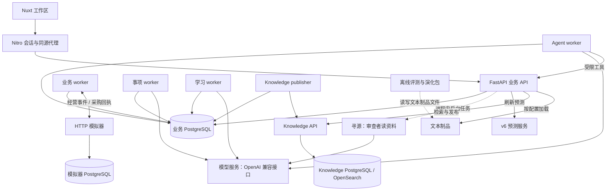

# 项目架构与数据边界

更新于 2026-10-13（Asia/Shanghai），对应分支 `YH`、业务迁移头 `0019_sourcing`。读者是项目成员、写报告“系统设计”一节的人和之后接手的人。本页说明系统由哪些进程组成、每类数据归谁、几条业务链路怎么走、模型用在哪里，以及设计里有而代码里还没有的部分。安装和启动命令见[根 README](../README.md)。

本页只写代码里已经存在并接通的东西。每条链路是否在真实模型和浏览器里验证过，以各自的验证文档为准，本页最后一节给出入口。

几个词在本页里的意思：

- **Mission**：店主交给系统持续跟进的一项备货委托，绑定一家门店和一个商品。
- **Plan**：一次检查给出的候选方案，带输入证据和哈希。店主批准后才会执行。
- **Action**：一笔已批准的采购，从发出到回执的全过程。
- **恢复 Case**：原订单晚到或数量不够时，在某个 Mission 上开的一件“供应异常应对”事项。
- **寻源**：从供应商发来的资料里读出报价，交给求解器比较。
- **辅助发送**：系统不联系供应商，订单由店主自己发出，再把回复粘贴回来。
- **文本制品**：带版本号和哈希的提示词文件，是离线演化唯一允许改动的对象。

## 1. 进程与数据

| 进程 | 入口 | 做什么 | 统一启动器是否启动 |
|---|---|---|---|
| 前端 | `corepack pnpm --filter @shopsteward/frontend dev` | 单页工作区，经 Nitro 代理访问后端 | 是 |
| 业务 API | `backend/`：`python -m app` | 全部 HTTP 接口；寻源的阅读在这个进程里后台运行 | 是 |
| 业务 worker | `python -m app.worker --profile business` | 同步模拟器事件、检查 Mission、执行采购、Case 自动跟进 | 是 |
| Agent worker | `python -m app.worker --profile agent` | 运行 Mission Agent 的对话和后台跟进 | `AGENT_ENABLED=true` 时 |
| 事项 worker | `python -m app.worker --profile work` | 处理“交给我一件事”和报价整理 | `WORK_PROCESSOR_ENABLED=true` 时 |
| 学习 worker | `python -m app.worker --profile learning` | 从经营操作里提炼候选经验 | `LEARNING_ENABLED=true` 时 |
| 模拟器 | `simulation/`：`python -m simulator` | 模拟时间、销售、到货和采购回执 | 是 |
| v6 预测 | `python -m uvicorn shopsteward_ml.service:create_app --factory` | 七日销量预测 | `FORECAST_V6_ENABLED=true` 时 |
| Knowledge API、worker、publisher | `infra/compose.knowledge.yaml`、`python -m app.knowledge.publisher` | 文档解析、索引、检索 | 否，见[部署手册](runbooks/knowledge-server-handoff.md) |
| 离线评测与演化 | `posttraining/`，命令见[评测运行说明](runbooks/strategy-evaluation.md) | 按 rubric 评分、GEPA 文本演化 | 不属于在线系统 |

统一启动器是 `infra/start_windows.py`，加 `--overlay <文件>` 可以为一次启动换一套模型或数据库配置而不改 `backend/.env`。业务 worker、Agent worker、事项 worker、学习 worker 是四个互不替代的进程，各自只处理自己的任务类型。`agent/` 不是独立服务，它是被 worker 和 API 加载的运行时包。

寻源的阅读没有走持久任务队列：它是 API 进程里的一个后台任务，一次最长 300 秒。API 在阅读中途重启时，这次寻源显示为中断，需要重新发起。原因是前端每个请求 25 秒超时，而一轮阅读要一分钟左右。

## 2. 数据归属

| 数据 | 归谁 | 约束 |
|---|---|---|
| 库存、现金、销售、在途、账本 | 业务后端 | 唯一的经营事实来源。模型的文字和界面上的表格都不能直接改账 |
| Mission、Plan、批准记录、Action | 业务后端 | Plan 内容不可变；批准绑定商品、供应商、数量、金额、状态版本和方案哈希 |
| 恢复 Case 及其版本、证据、事件 | 业务后端 `operations_cases` | 绑定已有的 Mission；每个 Case 最多一笔已受理的应急采购 |
| 供应商资料、寻源记录、从资料读出的报价 | 业务后端 `sourcing` | 资料按门店和供应商存放在 `supplier_documents` 表；读出的报价登记为门店报价并留下出处。已对接供应商的报价不会被资料覆盖 |
| 订单信息、供应商回复、回执、登记的到货 | 业务后端 `execution` | 只有走辅助发送的订单才有这些字段 |
| 对话、消息、Agent 运行、工具调用记录 | 后端 Agent 桥接层 | 按用户、门店和任务隔离 |
| 图检查点、记忆、任务 Skill | Agent 运行时和桥接层 | 动态的库存和现金不写进记忆 |
| 事项、事项消息、处理结果、持久报价 | 后端 `work_items`、`quotations` | 先保存用户的一件事，不复制账本 |
| 学习设置、经营片段、候选经验、质量报告、使用记录 | 后端 `learning` | 学习默认关闭，按用户和门店隔离；用户可以让系统忘记某项经验 |
| 预测输入、预测证据、当前绑定 | 后端 `forecast_v6` | 绑定门店、商品、模型版本和状态版本 |
| 模型权重、特征计算、原始推理输出 | `ml` | 加载时校验文件哈希；不决定采购数量 |
| 文档、版本、原件、交付队列 | 后端 `knowledge` | publisher 负责交给 Knowledge 服务 |
| 解析块、检索索引、文档关系 | Knowledge 服务 | 自己的数据库和 OpenSearch |
| 模拟时间、外部经营事件、模拟的采购回执 | 模拟器 | 独立数据库；后端拉取后按规则入账 |
| 文本制品 | 仓库里的文件 `agent/src/shopsteward_agent/cases/bundles/` | 带内容哈希，已保存的版本不可覆盖；产品靠配置选择用哪个版本 |

供应商资料和 Knowledge 的文档是两套存储，目前没有打通：寻源只读 `supplier_documents`，不经过检索服务。

## 3. 业务链路

### 3.1 备货、采购与持续跟进

1. 店主在合成环境里初始化场景，业务 worker 从模拟器导入状态并持续同步事件。
2. 店主建立 Mission，定下商品、现金底线、供应商和候选数量。定时、事件和手动检查都会触发规划。
3. 后端读一致的快照，生成带版本和哈希的 Plan 与警报。数据过期或输入不全时不发布可执行的方案。
4. 店主批准某个 Plan。后端重新核对版本、资金和权限，记下 Action 并执行。模型没有批准采购的工具。
5. 模拟器给出回执和到货、销售事件，后端按唯一标识去重入账。结果不明时沿原 Action 核对，不重复下单。

### 3.2 供应异常应对

店主在 Mission 的“供应异常应对”里建一件恢复 Case，补充预算、数量范围和七日日需求。日需求可以手填，也可以直接用已启用的 v6 预测。求解器按天推演库存，在预算、现金底线、起订量和整包约束下比较“等待”和最多三份报价，给出候选和推荐。选定候选只生成待确认的 Plan，批准、预留资金、发送和回执仍走 3.1 的链路。配置了模型时，解释步骤把求解结果讲成带出处的说法；计算和批准不依赖模型。

### 3.3 寻源

在恢复 Case 上点“开始寻源”后，系统先算出不补货时的缺口，作为对每位审查者提出的需求。每家有资料在档、且未对接的供应商分到一位审查者，最多三位同时读。审查者只能读自己那一家的资料，交回一张报价卡，每个字段附资料原文作引文。代码核对引文：引文在审查者打开过的资料里找不到，这张卡不采用并重读一次。通过的报价取最便宜的三家登记为门店报价，Case 生成新版本并求解。

审查者从不选择供应商或数量，这两件事由求解器决定。这是这条链路里多个 Agent 分工的依据：每位审查者的上下文只有一家供应商的资料，互相看不到。

### 3.4 辅助发送、回执与到货

1. 从资料读出的供应商没有可以直接下单的系统，所以这类订单总是走辅助发送。其余订单由 `PURCHASE_CHANNEL` 决定。
2. 店主批准后，系统预留资金并生成一段订单信息，中英文各一份。店主用自己的微信或 WhatsApp 发出。
3. 店主把供应商的回复粘贴回来。模型或固定规则读出接受与否、数量、单价、金额、送达日期，每一项必须引用回复原话。
4. 回复接受且与订单一致：采购入账，库存记为在途。回复拒绝：订单关闭，资金释放。回复含糊或与订单不一致：订单保持待确认。供应商一直不回复时，店主可以撤回订单。
5. 货到店后，店主在事项页的“货到后在这里登记”里填到货件数。在途转为在库，账本记一笔到货，可以分几次登记。模拟器不知道这类订单，所以到货只能由店主登记。

登记回复和撤回订单需要审批权限，登记到货需要操作权限。

### 3.5 Mission Agent 对话

用户消息进入持久的对话和运行记录，由 Agent worker 执行 LangGraph 工具循环。模型能调用 15 个受限工具：读取 Mission、Plan、看板、预测、Action、时间线、销售汇总和恢复 Case，请求重新检查，只读试算，明确要求时修订方案，分析恢复 Case，读写记忆，读取过往经验。启用 Knowledge 后另有两个文档工具。

修订方案只生成新的待确认 Plan，采购仍要店主批准。输入准入、上下文预算和调用账本由 Context Engineering 一层处理，前端的上下文检查器能看到每次调用用了哪些来源。

Agent 对话里目前不能发起寻源，寻源只能从面板上的按钮发起。

### 3.6 主动事项与报价

“交给我一件事”先保存为事项，由事项 worker 处理：多轮澄清、真实查询、数量比较、关联已有 Mission、给出待接受的委托条件。报价整理接受 CSV，服务端换算和纠正，结果不可变。

自由文本的事项目前不会自动转成恢复 Case，Case 只能从已有 Mission 进入。

### 3.7 预测

v6 模型包由四个组件组成，随仓库分发。后端经 ML 服务刷新预测，保存输入和不可变的预测证据。只有“观察历史”输入并显式选择后，预测才用于正式规划；历史示例只供演示。预测只给出七日销量，现金、库存、报价和数量仍由后端计算。

### 3.8 Knowledge

后端管理文档和原件，publisher 把待交付的文档交给 Knowledge 服务，服务侧解析、索引并提供检索。历史引用绑定文档版本和内容校验值。Mission Agent 通过两个文档工具取证据。

### 3.9 经验学习

1. 店主在“学习与经验”页打开学习后，经营操作被记成按事项归并的片段。
2. 学习 worker 在片段够数时调用模型，提炼出结构化的候选经验。候选引用的证据必须是真实记录过的事件。
3. “检查质量”做契约检查：结构、所需工具是否存在、证据是否真实。其余项目需要独立回放和人工复核，产品里没有做，报告里如实记为未验证。
4. 启用有两条路。完整通过质量门槛的可以直接启用，这需要维护者用可信命令行登记带回放结果和两人复核的报告。只通过契约检查、其余没测过的，店主可以自己“按有限证据启用”，页面会一直标明“证据有限”。有任何一项检查失败的不能启用。
5. 启用的经验在 Agent 对话开始时按适用条件检索，最多三条注入上下文。每次使用前重新核对质量报告、工具清单和模型配置，对不上就自动暂停。

金额、权限和采购确认不受经验影响，仍由业务规则把关。

## 4. 模型用在哪里

所有模型都经 OpenAI 兼容接口调用，由配置指定，可以分属不同的服务商。

| 位置 | 配置 | 说明 |
|---|---|---|
| Mission Agent、事项 worker、经验提炼 | `AGENT_MODEL`、`AGENT_BASE_URL`、`AGENT_API_MODE` | 需要工具调用 |
| 恢复 Case 和寻源方案的解释 | `AGENT_CASE_MODEL`、`AGENT_CASE_API_MODE` | 一次调用，输出约 4,000 token |
| 读供应商资料、读粘贴的回复 | `AGENT_SOURCING_MODEL`、`AGENT_SOURCING_BASE_URL` 等 | 可以用便宜的模型，与解释的模型分开 |
| 离线演化的反思 | 评测命令的 `--reflection-model` | 只在离线运行 |

### 后训练的位置

设计里有一格留给专门训练的小模型：在补货对话里只做“选哪个工具、填什么参数、缺信息时问什么”这一件事，先做监督微调，再用模拟器的反馈做强化学习。这一格的运行时在 `agent/src/shopsteward_agent/task_policy/`，评测在 `posttraining/src/shopsteward_pt/eval/`。训练本身没有做，这一格也没有接进产品的对话主循环。

当前这一版演示不做后训练：这一格由现成的模型直接担任，并用同一套评分规则和原有的规则基线、模型基线比较。比较的做法和结果见[成熟模型对比](reports/2026-10-13-mature-model-comparison.md)。

## 5. 评测与自进化

评测全部离线运行，不连接业务数据库和供应商。

| 评测 | 位置 | 评什么 |
|---|---|---|
| 受限决策 | `posttraining/src/shopsteward_pt/eval/` | 工具选择、参数、澄清是否正确；代码判分，澄清问题另需逐条复核 |
| Case rubric v1 | `posttraining/src/shopsteward_pt/case_eval/` | 六个结果维度和六个过程维度、关键失败、三态结果 |
| 策略与寻源 | `posttraining/src/shopsteward_pt/strategy_eval/` | 解释是否忠于求解结果；寻源的阅读、把关、推荐、解释各环节是否通过 |

自进化是对文本制品的离线优化，分四步：在场景上运行并分环节评分；把失败原因写成文字；由 GEPA 提出新文本；新文本存成带父版本和来源的制品，靠配置启用。优化器不能改评分器、标准答案、把关代码和求解器。

产品里和这条线接通的有三处：寻源记录里保存每次把关的理由和被拒的原文；`AGENT_SOURCING_TEXT_BUNDLE`、`AGENT_SOURCING_REVIEW_BUNDLE`、`AGENT_CASE_TEXT_BUNDLE` 选择文本版本；“学习与经验”页底部的世代表列出每个版本改了什么、用在哪一步。

目前启用的 `sourcing-r1-s1` 是两次搜索产出的候选之一，没有做过与父版本的放行比对。它说明这条链路能跑通，不说明它比原文本好。

## 6. 设计里有、代码里没有的

| 设计 | 状态 |
|---|---|
| 受限流程执行器、新路线候选、A2UI 界面 | 没有实现 |
| 人工写好的基线 Skill 和 `SKILL.md` 导出 | 没有实现 |
| 多商品联合备货和 CP-SAT 求解器 | 没有实现；现在是单门店单商品 |
| 任务模型的监督微调和强化学习 | 没有做；评测框架和规则、模型两条基线已有 |
| 自由文本事项自动转成恢复 Case | 没有实现 |
| 寻源读 Knowledge 里的文档 | 没有打通，两套存储 |
| Agent 对话里发起寻源 | 没有对应的工具 |
| 产品里的寻源失败自动进入失败台账 | 没有打通；台账命令只读离线评测的结果目录 |
| 多专家协作策略的用例 | 三种多专家策略的代码都在，默认用固定流程，没有哪条产品链路在用 |

## 7. 契约、迁移与验证入口

- 业务接口以 [`backend.runtime.openapi.json`](api/backend.runtime.openapi.json) 为准，当前 93 条路径、106 个操作。前端类型和代理白名单由它生成。
- 改接口、字段或状态码之前，先查[前端对接说明](../frontend/docs/frontend-integration.md)：它按接口列出前端在哪些板块用到了它，并给出改动后的同步清单。
- 业务迁移头 `0019_sourcing`，模拟器 `sim_0003_controls`，Knowledge `knowledge_0002`。更新代码不会自动迁移数据库或重启进程。
- 寻源和辅助发送的启用、演示步骤和验证情况见[寻源与辅助发送](sourcing-and-assisted-purchase.md)。
- 恢复 Case、Context Engineering 和专家解释见[下一阶段运行手册](runbooks/next-phase-agent-recovery.md)。
- 经验学习见 [Skill 学习运行说明](runbooks/skill-learning.md)。
- 当前的工作现场和待办见[最新会话交接](reports/2026-10-13-demo-handover.md)。
